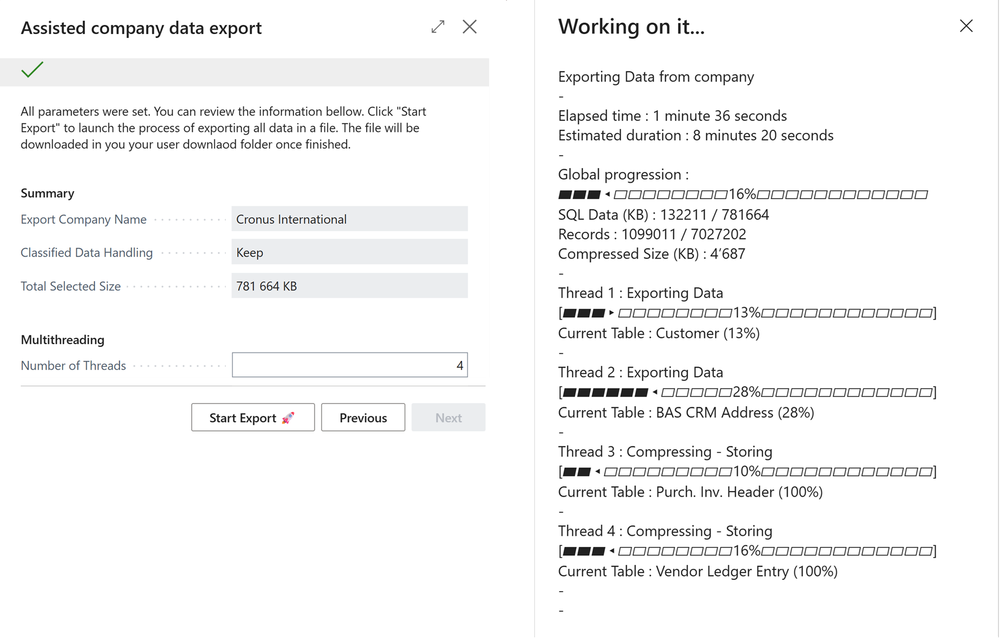
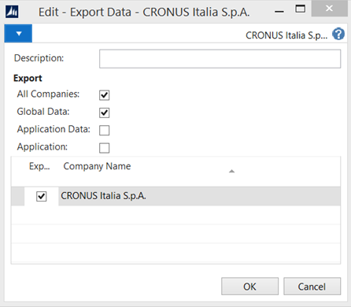
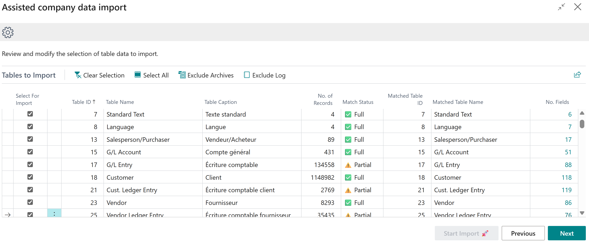
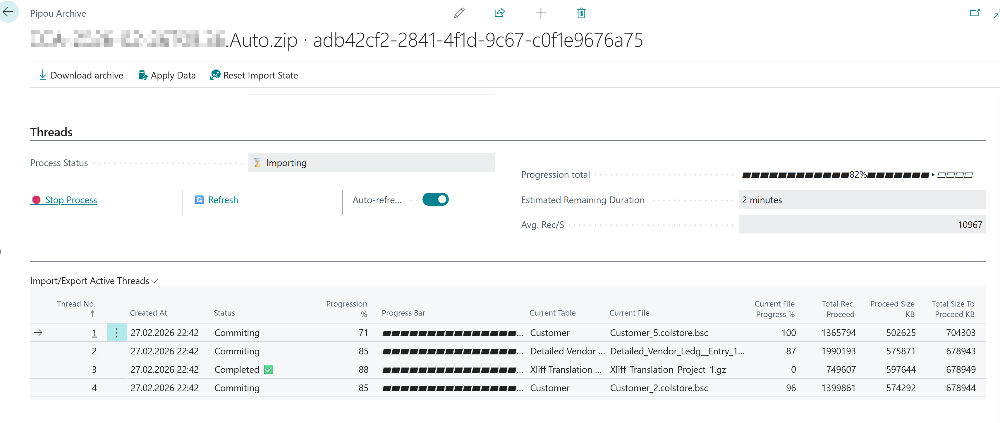
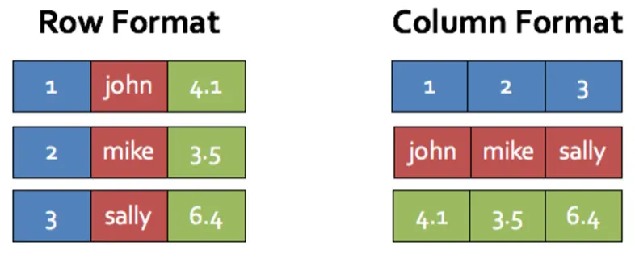
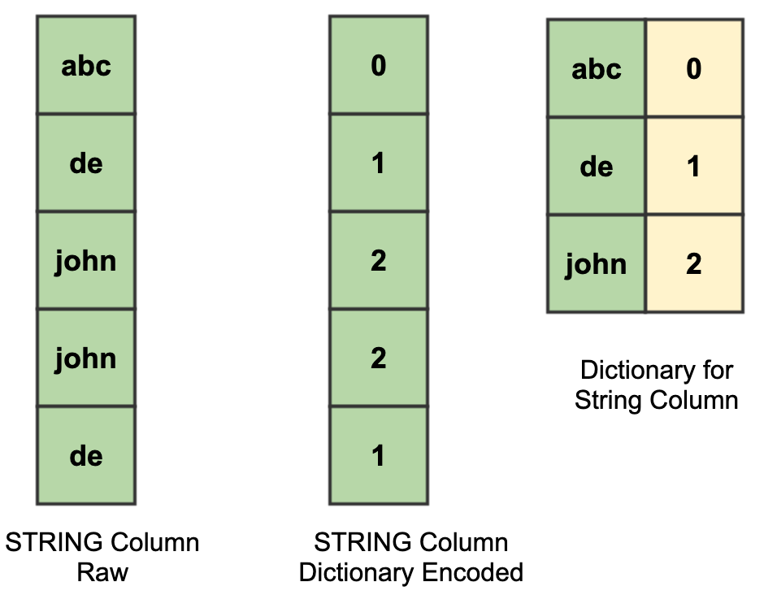

# AL Company Data Import / Export

[](LICENSE.md)
[](https://github.com/MaximeCaty/AL-Company-Data-Import-Export/releases)
[](#install)
[](#5-saas-vs-on-premise)

**Copy one company between Business Central environments — any version, any schema.**
Export a company to a compressed archive, import it into another instance: different BC version, different extensions, different tenant. On-premise or SaaS.

The modern replacement for NAV's *"Import / Export Data File"* — without the frozen client, the all-or-nothing rollback, or the failure on the first schema difference.



**8.6 million records · 45 GB database → 220 MB archive → imported in 14 minutes.** *(on-premise, 4 threads — full numbers in [Performance](#4-performance))*

- **Pick what you copy** — per-table selection, with or without logs, archives, global data, system fields.
- **Schema mismatch is handled** — tables and fields are auto-matched across versions; you review and override the mapping before import.
- **Nothing freezes** — multithreaded, progress per thread, errors logged and skipped instead of rolling back everything.
- **Small archives** — column-oriented binary format with dictionary encoding; zStd / libbsc / kanzi compressors on-premise.

## Install

1. Download the `.app` from **[Releases](https://github.com/MaximeCaty/AL-Company-Data-Import-Export/releases)** — SaaS or On-Premise version.
2. On-premise: optionally add the SQL bulk-insert DLL and the compressor executables for ~3× faster imports and ~40% smaller files → [On-Premise setup](#on-premise-setup).
3. In the web client, search **"Assisted company data export"** / **"Assisted company data import"**.

Requires Business Central **23.0 or later**.

## Contents

1. [How to use](#1-how-to-use)
2. [Why not the legacy NAV tool](#2-why-not-the-legacy-nav-tool)
3. [Screenshots](#3-screenshots)
4. [Performance](#4-performance)
5. [SaaS vs On-Premise](#5-saas-vs-on-premise)
6. [Installation details](#6-installation-details)
7. [Archive format internals](#7-archive-format-internals)
8. [License & feedback](#8-license--feedback)

---

## 1. How to use

### Export

Search for the page **"Assisted company data export"**:

1. Select the company to export.
2. Choose the data scope: classified data, system fields, include global data / logs / archives.
3. Pick the archive format (**Auto** by default — see [Compression modes](#compression-modes)).
4. Review the list of tables included. Remove tables manually if you want.
5. Review the summary and start.

> 💡 Use at most **2 threads** when the instance is in use — exporting competes with your users for CPU and SQL.

### Import

Create a new **blank company** first, then search for **"Assisted company data import"**:

1. Upload an archive — the system reads its metadata and prepares the import.
2. Select the destination company.
3. Review the table list and the matching (see the mapping screenshot below).
4. Review the summary and start.

Same advice: 2 threads max on a live instance.

**Table & field mapping.** At step 3 you can change any table mapping with the column *Matched Table ID*. Drill down on the *No. fields* column to adjust field mapping for a table.
- ⚠️ **Partial** — some fields are not mapped to the destination table.
- ⛔ **Missing** — the table is not mapped to any destination table.

Progress shows either in a foreground dialog or on a separate page listing every thread, with an action to stop all threads.

---

## 2. Why not the legacy NAV tool

If you ever watched NAV's *Export Data* lock a client for an hour and then roll back on one bad field — this is for you.

| | Legacy NAV "Import / Export Data File" | This extension |
|---|---|---|
| Data selection | Whole database, global data Y/N | ✅ Per table, per scope |
| Schema differences | ❌ Fails on the first mismatch | ✅ Auto-match + manual mapping |
| Client during the run | ❌ Frozen | ✅ Assisted setup, per-thread progress |
| Error in the data | ❌ Full rollback | ✅ Logged, continues with the next chunk |
| Threads | ❌ Single | ✅ Multithreaded |
| Archive size | No compression - plain rows binary data from SQL | ✅ Column-oriented + shared dictionaries + frontier compression |
| Several companies in one archive | ✅ | ❌ One company per archive |

<table>
<tr>
<th>NAV — Export Data File</th>
<th>This extension — Assisted export</th>
</tr>
<tr>
<td></td>
<td></td>
</tr>
</table>

---

## 3. Screenshots



*Import step 3: every source table matched to a destination table. Override the mapping per table, drill down to remap fields.*



*Import progress per thread, with a stop-all action. Works as a foreground dialog too.*

---

## 4. Performance

Version 2.0.0.0, 4 threads, Auto format, without system fields.

| | Cronus W1 (BC 23) | Real company |
|---|---|---|
| Database size (MDF) | 1 GB | 45 GB |
| Tables with data | 548 | 365 |
| Records | 43 783 | 8 662 740 |
| **Export** (cloud format) | 4.1 s | 6 min |
| Archive size — GZip (SaaS) | 3.2 MB | 252 MB |
| Archive size — max compression (on-prem) | 2.8 MB | 220 MB |
| **Import** (native AL) | 7.8 s | 49 min |
| **Import** (on-prem SQL DLL) | 7.0 s | 14 min |

<details>
<summary>Compared to v1.0.0.0</summary>

| | Cronus W1 | Real company |
|---|---|---|
| Export duration | 4.4 s → 4.1 s (−6%) | 12 min → 6 min (−50%) |
| Archive size (GZip) | 3.5 MB → 3.2 MB (−8%) | 357 MB → 252 MB (−30%) |
| Archive size (on-prem max) | — → 2.8 MB (−20%) | — → 220 MB (−43%) |
| Import duration | 9.3 s → 7.8 s (−16%) | 53 min → 49 min (−7.5%) |
| Import duration (SQL DLL) | 8.3 s → 7.0 s (−15%) | 17 min → 14 min (−17%) |

</details>

---

## 5. SaaS vs On-Premise

Everything works on both. When exporting from OnPremise you may select a data format to use :
> 💡 On-premise can use DLL and external compressors for faster and smaller archive, which SaaS cannot import.

| | Cloud format | DotNet (OnPrem only) format |
|---|---|---|
| Compression | GZip — archives ~35% larger | zStd + libbsc / kanzi |
| Import speed | Native AL | SQL bulk insert via DLL — ~3× faster on large tables |
| System fields (`SystemCreatedAt/By`, `SystemModifiedAt/By`) | Original values lost | Original values restored via SQL |

---

## 6. Installation details

Both `.app` files and the on-premise DLL / compressor bundle are on the [Releases](https://github.com/MaximeCaty/AL-Company-Data-Import-Export/releases) page.

### On-Premise setup

1. Allow writes inside `TryFunction` on the service instance:
   ```powershell
   Set-NAVServerConfiguration -ServerInstance <Instance> -KeyName DisableWriteInsideTryFunctions -KeyValue false
   ```
2. **BC 27+** — allow the app to reach the DLL and compressor executables:
   ```powershell
   Set-NAVServerConfiguration -ServerInstance <Instance> -KeyName EnforceUserPathForAlFileOperations -KeyValue false
   ```
3. Copy the DLLs from [`AL Company Export-Import/.netpackages/`](AL%20Company%20Export-Import/.netpackages/) (also in the release zip) into the Business Central `Service/Add-ins` folder.
4. Restart the service instance.
5. Publish the app.

**❗ Recommended for smaller archives:** put `bsc.exe` and `kanzi.exe` in the same `Add-ins` folder. The app uses them automatically when present. Both are in the release zip; originals:
- [libbsc by Ilya Grebnov](https://github.com/IlyaGrebnov/libbsc/releases/tag/v3.3.12)
- [kanzi-cpp by Frederic Langlet](https://github.com/flanglet/kanzi-cpp)

Source of the DLL: [`BCBulkInsertHelper DLL/`](BCBulkInsertHelper%20DLL/).

### Cloud

Upload the SaaS `.app` from Releases. No DLL, no compressor executables — nothing else to do.

To build it yourself from source, two edits in [`app.json`](AL%20Company%20Export-Import/app.json):

1. Remove the `ONPREM` preprocessor symbol:
   ```json
   "preprocessorSymbols": [
     "ONPREM"   <- remove
   ]
   ```
2. Set `"target": "Cloud"`.

That's it — the extension compiles for SaaS.

---

## 7. Archive format internals

How data is laid out inside the archive. Not needed to use the tool — read on if you're curious why the files are small.

### Compression modes

| Mode | Algorithm | Column-oriented | Dictionaries | Max chunk | System fields |
|---|---|---|---|---|---|
| **Auto (On-Premise)** | zStd → libbsc → kanzi \* | ✅ | ✅ | 75 MB | ✅ |
| **Auto (SaaS)** | GZip 6 / 9 | ✅ | ✅ | 200 MB | ❌ |

\* zStandard for small files (< 256 KB), then libbsc or kanzi for larger ones, depending on the compression level chosen in the wizard.

Manual modes — **GZip** (level 6/9), **zStd** (level 12/22), **Libbsc** (level 1/2), **Kanzi TPAQ** — expose the same settings (column storage, dictionaries, chunk size, system fields) individually.

<details>
<summary><b>Archive structure</b></summary>

```
Archive.zip/
|   datameta.json                 // table schemas, file list, general info
|   Table1_File1.gzip             // table chunk, row-oriented
|   Table1_File2.gzip             // table chunk, row-oriented
|   Table2_File1.gzip             // table chunk, row-oriented
...
|   Table18_File1.colstore.bsc    // table chunk, column-oriented: a compressed TAR containing
|   |   +-- columns.json          //   column definitions
|   |   +-- Column_1.bin          //   column 1 binary stream
|   |   +-- Column_2.bin          //   column 2 binary stream
|   |   +-- Column_3.bin          //   column 3 binary stream
...
|   dict/
|   |   optionset.bin             // ordinal index of every option/enum with <= 256 values
|   |   Vendor$No.bin             // single-byte index for Vendor "No." when < 254 distinct values
```

</details>

<details>
<summary><b>How data is encoded</b></summary>

Data is written in binary, which parses faster and packs smaller than text formats like CSV. Streams contain raw table data only — no headers, no separators.

- **Row-oriented** — small tables (< 100 rows): simple, low overhead.
- **Column-oriented** — larger tables (≥ 100 rows): better compression, faster import, and empty columns are skipped entirely (detected by comparing to BC default values). Stored as a compressed TAR: one stream per column + a JSON with column definitions.
- **MD5 check** after each file is decompressed, to guarantee integrity.



</details>

<details>
<summary><b>Dictionaries</b></summary>

Compressors are great at squeezing repeated values, but when a field holds a small fixed set of values referenced thousands of times across tables, it's cheaper to write the list once and store a single-byte index everywhere else. Smaller files, faster read and write.



Candidates are detected automatically:
- **Option / Enum fields** — whenever the option has fewer than 256 ordinals (almost all of them): the 4-byte AL ordinal becomes a 1-byte index. The index → ordinal map lives in `optionset.bin` (usually ~1 KB).
- **Text / Code fields** — when the field is a table relation (foreign key) with ≤ 254 distinct values, and the referencing table has at least 1.86× more rows than the parent, so the dictionary pays for itself (e.g. 100 vendors referenced by 500 vendor ledger entries).

</details>

<details>
<summary><b>Table chunking</b></summary>

Each file has a size limit, to bound RAM while reading / writing and to spread database commits during import. When a stream reaches the limit, the file is closed and compressed and a new stream starts for the remaining records.

On import, a commit happens at the end of each chunk. A large table may be imported by two or more threads at the same time.

> Libbsc and kanzi need a lot of free RAM — roughly **5× the file size, per thread**.

</details>

---

## 8. License & feedback

Free and open source under the [GPL-3.0 license](LICENSE.md).
Bug reports, feature requests and benchmark numbers from your own databases are welcome in [Issues](https://github.com/MaximeCaty/AL-Company-Data-Import-Export/issues).
